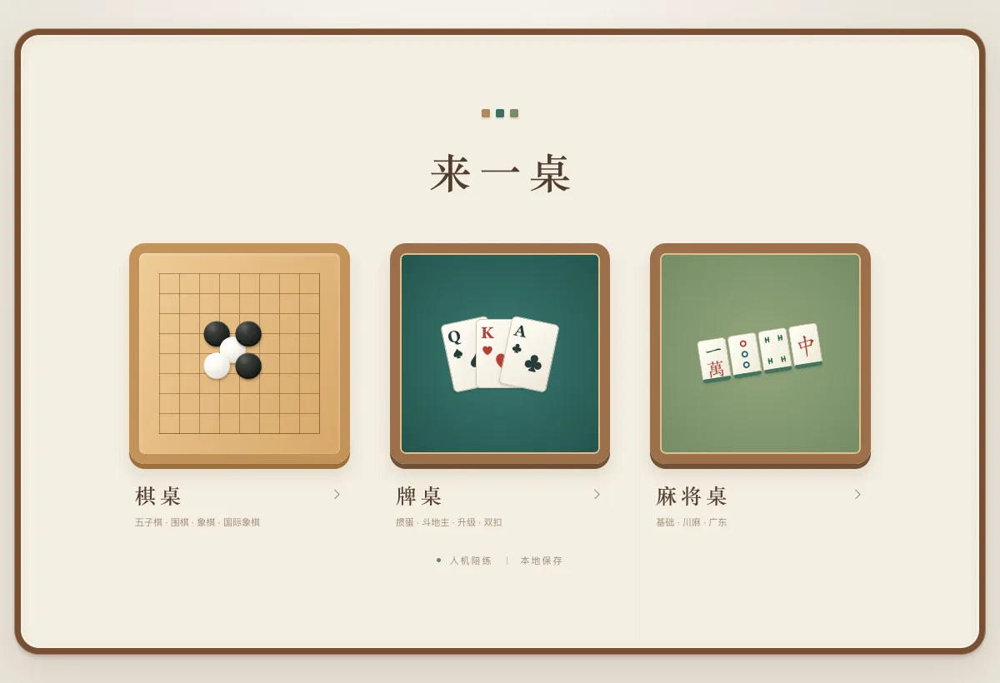
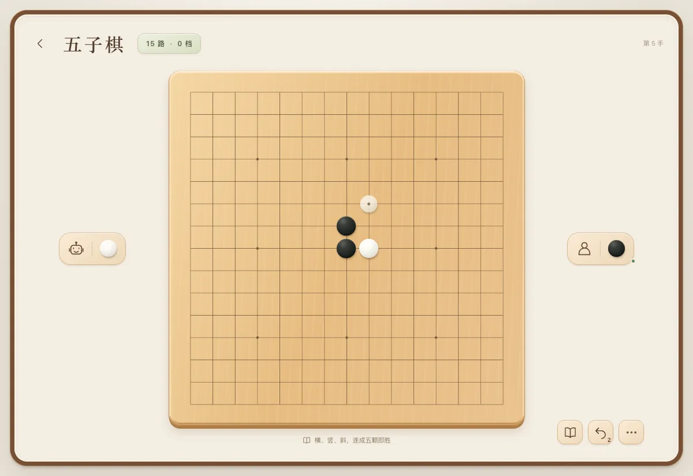
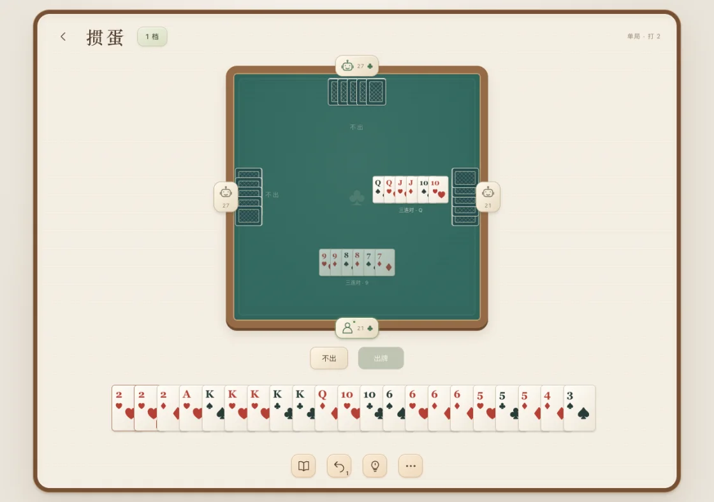
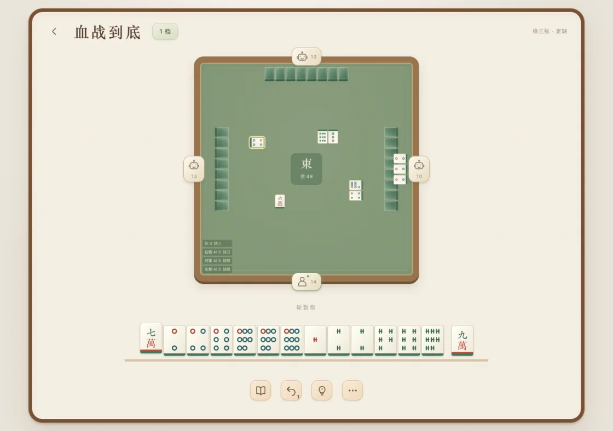

# 来一桌

DeepSeek Harness 的本地棋牌陪练插件。一个人也可以开棋桌、牌桌或麻将桌，由电脑应手。游戏无需配置模型账号，未结束的对局保存在本机。

[项目主页](https://linguista.cn/workshop/lai-yi-zhuo/) · [安装](#安装) · [对局演示](https://linguista.cn/build/lai-yi-zhuo-overview/) · [发行版本](https://github.com/Linguage/dsh-lai-yi-zhuo/releases) · [MIT](LICENSE)



## 安装

1. 在 DeepSeek Harness 打开「插件 → 添加插件」，粘贴仓库地址。

   ```text
   https://github.com/Linguage/dsh-lai-yi-zhuo
   ```

2. 安装后点击「立即启用」，从侧栏打开「来一桌」。

兼容 DeepSeek Harness `>=0.2.0-0 <0.3.0`。也可以从 [GitHub Releases](https://github.com/Linguage/dsh-lai-yi-zhuo/releases/latest) 下载 `.tgz` 安装包，在添加插件时填写文件的绝对路径。

## 快速开始

想先试一局，可以选「棋桌 → 五子棋」，用 0 档执黑，点棋盘上的交叉点直接落子。电脑应手后，可以点右下角的悔棋，回到自己的上一步再试。0 档可以连续回退两次，1 档可以回退一次。1、2 档可以打开建议，棋桌的实验胜率可以单独开关。

返回大厅后，可回到相同玩法继续未结束的对局。五子棋和围棋共用一个存档槽，新开一局会替换该槽里的存档。

## 玩法与界面

| 棋桌 | 牌桌 | 麻将桌 |
| --- | --- | --- |
| [](docs/images/gomoku.webp) | [](docs/images/guandan.webp) | [](docs/images/sichuan.webp) |
| 五子棋、围棋、中国象棋、国际象棋 | 掼蛋、斗地主、升级、双扣 | 基础麻将、川麻血战到底、川麻血流成河、广东推倒胡 |

各桌采用的规则见[玩法与陪练档位](docs/game-rules.md)。

## 文档

- [部署指南](docs/deployment.md)涵盖安装包、升级和排障。
- [维护与扩展指南](docs/maintenance.md)涵盖本地开发、测试和发版。
- [问题反馈](https://github.com/Linguage/dsh-lai-yi-zhuo/issues)可附玩法、复现步骤和 DeepSeek Harness 版本。

## 致谢

感谢以下开源项目及其维护者。

| 项目 | 在来一桌中的用途 |
| --- | --- |
| [DeepSeek Harness](https://github.com/deepseek-ai/deepseek-harness) | 提供插件运行环境和侧栏入口。 |
| [chess.js](https://github.com/jhlywa/chess.js) | 生成并校验国际象棋走法，判定将死和和棋。随包分发，采用 BSD-2-Clause。 |
| [React、React DOM 和 Scheduler](https://github.com/react/react) | 渲染大厅与对局界面，调度渲染任务。随包分发，采用 MIT。 |
| [Vite](https://github.com/vitejs/vite) | 构建界面和后台计算线程。 |
| [TypeScript](https://github.com/microsoft/TypeScript) | 检查游戏规则和界面代码的类型。 |

README 的组织方式参考了 [CC Switch](https://github.com/farion1231/cc-switch/blob/main/README_ZH.md)。

## 开源协议

来一桌自有代码采用 [MIT 许可证](LICENSE)。随包分发的第三方组件沿用各自的协议，详见[第三方许可声明](THIRD_PARTY_NOTICES.txt)。
