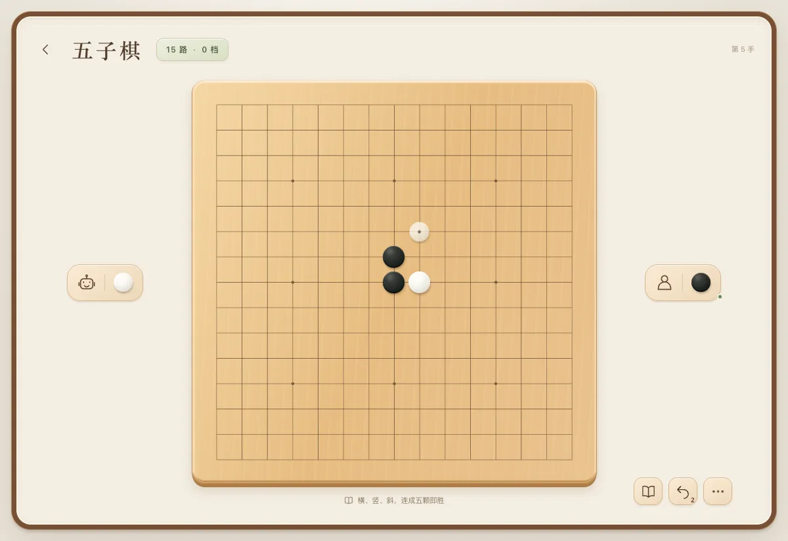

# 玩法与陪练档位

[返回 README](../README.md)

## 棋桌功能

- 首页进入棋桌，再选择四种棋之一。进入对局流程后选择执黑／执白与难度，再开始对弈。
- 五子棋为 15×15 自由规则，连续五颗或更多同色棋子即胜，无禁手。满盘无胜方为和棋。
- 围棋为 9×9 或 19×19。固定面积计分、白贴 7.5 点、禁止自杀、位置超级劫（落子不能重现历史盘面）。停一手不受重复局面限制。
- 围棋正确提子、显示提子数；连续两次停一手后由玩家点选死子，确认数子，或继续下。未自动判定死活，也未模拟 AI 与玩家协商死子的过程。
- 五子棋、围棋点击交叉点直接落子；象棋、国际象棋先选棋子再点目标位置，不追加落子确认。国际象棋兵升变时选择具体棋子。支持方向键和回车操作。
- 0 档自动显示一句规则提示。1、2 档可开关建议。五子棋与围棋分别最多显示 1 或 2 个合法候选点和一句棋形说明。3、4 档不提供建议。
- 所有档位可独立开关胜率估算，默认关闭，始终从玩家所执颜色计算。五子棋、围棋音效也可关闭。
- 0 档可连续悔棋两手，1 档一手，2–4 档不可悔棋。每次退回玩家上一手之前，玩家走出新的一手后恢复可连续悔棋的手数。支持认输、重开、规则说明，以及刷新后继续未结束棋局。
- AI 在 Web Worker 内运行，规则模块再次校验返回的落子。悔棋、离开、重开时终止旧计算，不接受过期应手。计算失败显示重试入口。

## 牌桌与麻将桌

斗地主为真人 + 两位本地 AI，其余牌桌及麻将为真人 + 三位 AI，0–4 共五档。0 档显示一句规则提示，1、2 档可以开关建议；其它档不显示建议。桌面严格采用正方形，自己在下、AI 在上左右。掼蛋对家与玩家使用同队标记。

- 掼蛋：两副牌、每人 27 张、固定打 2，由玩家首攻的单局练习。支持单张、对子、三张、三带二、顺子、三连对、钢板、4–10 张炸弹、同花顺、四王炸与红桃 2 配牌。配牌有多种解释时可选牌型。点选／划选手牌后点一次「出牌」，不追加确认；支持不出、接风、跳过已出完者及四人游次结算。头游所在队获胜，暂不含跨局升级、进贡和还贡。
- 基础麻将：136 张无花牌，玩家坐东并先打。摸牌后点牌即打，也支持向桌心划出。支持吃、碰、明杠、暗杠、补杠、抢补杠、荣和、自摸和流局；吃限上家，胡高于碰杠，碰杠高于吃，多家胡按出牌后顺序取最近一家。四副面子加一对将、七种不同对子、十三幺可胡。不设番数门槛，无振听，不抢暗杠；不含地方番种、计分番或连庄。
- 悔牌与棋桌采用同样的连续回退规则：0 档两次、1 档一次、2–4 档无悔牌。每次回到自己上一次出牌或响应前，恢复三位 AI、牌墙、已出牌和鸣牌状态。合法新决策恢复可回退次数；刷新不会重置已用的连续深度。
- 各纸牌玩法、麻将版本及新增棋种分别保存一局，刷新或返回选桌后可继续。重新开局前保留原存档，直到再次开始练习才替换。
- 三位 AI 的 Worker 只接收自己的手牌、公开牌、公开剩余张数和合法操作；不传其它手牌或牌墙顺序。离开、回退和重开会取消计算及等待中的应手，返回动作再次经过规则校验。
- 牌桌可开关公开出牌进度，麻将可开关基础牌型向听数（不包含定缺及地方胡牌限制）。本版未实现这两种游戏的胜率概率模型，界面不把进度或向听数包装成胜率。原棋桌的实验胜率开关保留。

| 档位 | 掼蛋 | 麻将 |
| --- | --- | --- |
| 0 | 合法普通牌型随机选择 | 合法随机弃牌，出现和牌则和 |
| 1 | 出完优先、让同伴领出，低成本候选随机 | 连张、对子结构评分；有收益才吃碰 |
| 2 | 保留配牌和炸弹、避免拆组 | 最小向听数和基本牌形评分 |
| 3 | 结合剩余单张、对手报牌和同伴关系排序 | 向听数 + 公开信息下的有效进张数 |
| 4 | 进一步惩罚剩余散组 | 提高有效进张权重 |

这些是可解释的本地启发式档位，没有大模型调用或专业竞技强度标定；尚无跨回合信念推理、牌局学习或番种攻防。

## 其他棋种、牌类与地方麻将

| 游戏 | 可玩的流程 | 本版范围 |
| --- | --- | --- |
| 中国象棋 | 完整走子、将军、将死、困毙；马腿、象眼、炮架、九宫、过河、将帅照面校验 | 单方长将三次重复判负，其余三次重复或 60 回合无吃子和棋；不裁定复杂长捉 |
| 国际象棋 | 王车易位、吃过路兵、四种升变、将死、逼和、子力不足 | 使用 chess.js 1.4.0；三次重复与 50 回合规则自动判和，未采用赛事中的主动申诉流程 |
| 斗地主 | 三人一副牌，叫分、地主收底、农民合作、飞机及翅膀、炸弹、火箭、春天、积分 | 三家不叫时首家为 1 分地主；飞机单翅及四带二允许对子作为单牌 |
| 双扣 | 四人两副牌，对家组队，顺子、连对、连三张、同点炸弹、四王炸、接风、游次结算 | 普通无百搭，不含三带、连环炸；双扣 ±2、单扣 ±1、平扣 0 |
| 升级 | 双副、25 张手牌与 8 张底，亮主反主、扣底、主副牌、强制跟花色和对子／同长拖拉机、抓分抠底 | 固定打 2 单副；发完后依次亮主，最终亮主者坐庄；首引单张、对子、拖拉机，不支持混合甩牌；结算后下一副仍从 2 开始 |
| 川麻血战到底 | 108 张，顺时针换三张、定缺、禁吃、一炮多响、杠分、胡后离场、三家胡结束或牌墙空结算 | 固定简化番种；牌墙空查花猪、查叫、未听牌退杠分 |
| 川麻血流成河 | 同上，但胡后继续到牌墙空，可重复胡牌 | 本版胡后锁手，不再碰杠，只能摸切；不计开局天胡；自摸后移走本次摸牌，保留听牌结构 |
| 广东推倒胡 | 136 张，无鬼、不买马，禁吃，只能自摸或抢补杠胡；可碰杠，首家胡结束 | 固定简化番种，无连庄；普通弃牌不能胡 |

地方麻将的练习计分：平胡基础 1；碰碰胡加 1 番，七对、清一色各加 2 番；川麻每根、金钩钓各加 1 番。封顶 4 番，基础分最多 16；自摸每家加 1。明杠放杠者付 2、暗杠各付 2、补杠各付 1，广东抢杠由补杠者承担三家基础分。没有实现所有地方番种、赛事裁判细则或地区可选项。各玩法的具体约定在游戏内规则中可查。

新增棋类使用本地迭代加深搜索，0 档合法随机，1–4 档最多 1–4 层，计算预算约 90 / 300 / 650 / 1200 ms。建议用 2 档计算。新增纸牌根据公开信息、队友关系、牌型结构与主副牌策略分档，没有模型联网调用。所有档位仍未标定为人类段位或比赛强度。

## 棋桌引擎与限制

这是可以实际对弈的本地首版。原方案的 Rapfi / KataGo 尚未接入，也没有调用大模型。

| 档位 | 五子棋 | 围棋 |
| --- | --- | --- |
| 0 启蒙 | 较宽的候选点随机选择 | 较宽的合法候选点选择 |
| 1 入门 | 直接成五／防五，1 层搜索 | 提子、救急、气与布局启发式 |
| 2 练习 | 最多 2 层搜索，400 ms 预算 | 最多 24 次采样，4 手展望，400 ms 预算 |
| 3 进阶 | 最多 3 层搜索，850 ms 预算 | 最多 48 次采样，8 手展望，850 ms 预算 |
| 4 挑战 | 最多 4 层搜索，1500 ms 预算 | 最多 90 次采样，12 手展望，1500 ms 预算 |

五子棋使用候选点棋形评分与迭代加深的 alpha-beta 搜索。围棋使用战术启发式和根节点 UCB 分配的有限步采样，截断时使用棋子、气与空间影响评分。不同预算不构成已验证的棋力等级，尤其围棋 19 路的长期布局与死活判断仍弱。预算在计算边界检查，实际耗时随设备变化。

胜率采用局面评分的 sigmoid 映射，界面标为「实验」，菜单和规则中说明尚未校准。它不是经过自我对弈标定的胜率，也不是大模型或专业引擎的评估。确认终局后显示实际胜负对应的 0%／100%，和棋 50%。不要把首版数字用于判断人类段位或衡量训练提升。

后续可保留现有 `Position → Analysis` 接口，将对手、建议和胜率统一替换为 Rapfi / KataGo，并按棋种、棋盘尺寸和黑白双方测量分档强度。当前版本没有为未接入的远端引擎放置无效设置入口。

## 规则参考

规则参考：[British Go Association 规则比较](https://www.britgo.org/rules/compare.html)、[KataGo 规则说明](https://github.com/lightvector/KataGo/blob/master/docs/rules.html)。本应用明确采用上述固定规则组合，不宣称覆盖所有中国围棋比赛的裁判细则。

掼蛋基础牌型参考：[南京体育学院活动附则](https://www.nsi.edu.cn/ntzqxy/b3/a0/c3045a45984/page.htm)。本应用的单局范围、固定打 2、首攻、游次结算及基础麻将的具体约定以上文和游戏内规则为准；不宣称完整实现赛事规则。

规则实现参考 [chess.js 官方仓库](https://github.com/jhlywa/chess.js)、[WXF 象棋规则](https://www.wxf-xiangqi.org/images/wxf-rules/2018_World_XiangQi_Rules_English2018.pdf)、[JJ 斗地主说明](https://www.jj.cn/news/320/20110920103700018196.shtml)、[茶苑双扣说明](https://www.gametea.com/news/201508/3966.html)、[JJ 双升说明](https://www.jj.cn/tractor/)、[JJ 广东麻将说明](https://www.jj.cn/news/320/20111025103000019369.shtml)、[斗棋血流说明](https://www.douqi.com/games/detail/3683.html)。这些来源存在地区差异；本插件采用的取舍以上述范围与游戏内规则为准，不宣称逐条复刻任一平台。
